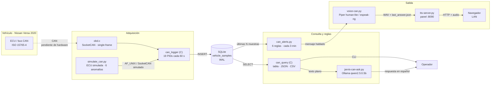

<div align="center">

# JarvisCAN

**Telemetría automotriz offline sobre Arduino UNO Q: CAN/OBD-II → SQLite → consultas en C → alertas por voz → panel web.**

[](https://en.wikipedia.org/wiki/C11_(C_standard_revision))
[](https://www.python.org/)
[](https://sqlite.org/)
[](https://systemd.io/)
[](https://www.arduino.cc/)
[](#estado-real-qué-funciona-y-qué-no)
[](LICENSE)

*Datos del vehículo en casa, voz local y cero nube.*

</div>

---

## Tabla de contenidos

- [Qué es JarvisCAN](#qué-es-jarviscan) · [Para qué sirve](#para-qué-sirve) · [Estado real](#estado-real-qué-funciona-y-qué-no)
- [Arquitectura](#arquitectura-extremo-a-extremo) · [Cómo se construyó](#cómo-se-construyó-evolución-y-decisiones) · [Componentes](#componentes)
- [Hardware](#hardware) · [Instalación](#instalación-paso-a-paso) · [Operación](#operación)
- [Consultas](#consultas-tabla-json-y-csv) · [Panel y API](#panel-web-y-api) · [Alertas](#alertas-por-voz) · [Asistente NL](#asistente-nl-en-la-práctica)
- [Rendimiento](#rendimiento-y-almacenamiento) · [Limitaciones](#limitaciones-honestas) · [Seguridad](#seguridad-y-privacidad)
- [Problemas](#solución-de-problemas) · [Estructura](#estructura-del-repositorio) · [Referencias](#referencias) · [Licencia](#licencia-y-autor)

---

## Qué es JarvisCAN

JarvisCAN es un sistema de telemetría automotriz que corre **íntegramente en una placa Arduino UNO Q**: lee parámetros del motor por el bus CAN del vehículo (hoy mediante un simulador OBD-II), los guarda en SQLite, los expone con un programa de consultas en C y dispara **alertas habladas** cuando se cumple una regla. Un panel web en el puerto `8090` muestra los monitores, el feed y reproduce los audios.

El vehículo objetivo es un **Nissan Versa 2020**, pero el diseño no depende del modelo: cualquier auto con OBD-II sobre CAN (ISO 15765-4) puede alimentarlo una vez resuelto el acceso físico al bus. No es un escáner comercial, no escribe en la ECU ni borra códigos, y no envía datos a ningún servidor. Es un proyecto de aprendizaje y portfolio, con límites explícitos.

**Filosofía:** local primero (sin backend, cuentas ni telemetría), componentes reemplazables (el mismo `can_logger` sirve para simulador o SocketCAN) y honestidad técnica (lo medido se distingue de lo estimado y lo pendiente).

---

## Para qué sirve

- **Registrar** una sesión de manejo o de taller en una base consultable, sin laptop encendida.
- **Consultar** el histórico por métrica, rango y agregación en tabla, JSON o CSV.
- **Detectar anomalías** (temperatura, niveles, presión, DTC, exceso de velocidad) y avisar por voz.
- **Mostrar una demo reproducible en LAN** y servir de base para el hardware real: al conectar el transceptor, el esquema y las consultas siguen válidos.

---

## Estado real: qué funciona y qué no

Fuente de verdad al **2026-11-11**. No se presentan como terminadas las partes probadas solo en simulación.

| Capacidad | Estado | Detalle verificable |
|---|---|---|
| CAN real del Versa | ❌ No disponible | Sin `can0`; `modprobe vcan` falla; no hay transceptor. |
| `can_logger` contra SocketCAN | ⚠️ Implementado, no validado en bus | Compila con `-Wall -Wextra`; soporta PF_CAN y `--iface unix:...`. |
| Simulador OBD-II | ✅ Funcional | 19 PIDs, 4 frames custom, 6 anomalías, ciclo de 300 s. |
| Base SQLite | ✅ Funcional | 436 muestras (2026-11-04/05); 401.408 bytes. |
| `can_query` | ✅ Funcional | 25 métricas, agregaciones, JSON/CSV/tabla, solo lectura. |
| Alertas (6 reglas) | ✅ Funcional | Desfase de 5 min, luego cada 3 min; WAV archivado. |
| Panel web `:8090` | ✅ Funcional | HTML/JS sin build, API JSON, audio, `monitor_active` real. |
| Piper TTS human-lite | ✅ Funcional | `es_MX-claude-high`; ~8–9 s por ~8 s de audio. |
| Fallback espeak-ng | ✅ Funcional | Si Piper falta; robótico y más rápido. |
| Asistente NL | ✅ Funcional | `qwen2.5:0.5b-instruct-q4_K_M` local; resumen determinista. |
| Autoarranque systemd | ✅ Funcional | Sim, alertas y panel con `Restart=always`. |
| `jarvis-can-logger` systemd | ⚠️ Preparado | La unidad existe, pero requiere `can0`. |
| Audio interno | ❌ No usable | `ArduinoImolaHPH` con errores de E/S; sin micrófono. |
| Bluetooth | ✅ Salida con EW02 Plus | A2DP funciona; el micrófono entrega silencio. |
| Micrófono | ⚠️ Solo IP Webcam | Android en `192.168.1.198:8080/audio.wav`; 16 kHz. |
| Auth del panel | ❌ No implementada | Solo LAN; sin TLS ni login. |
| Reloj | ❌ Sin NTP | Sin Internet; las marcas pueden desviarse. |

**Conclusión:** el pipeline completo está probado con datos simulados. La única pieza que falta para uso real es la interfaz física al bus CAN.

---

## Arquitectura extremo a extremo



1. **Origen.** El simulador (o la ECU real) produce valores OBD-II; el logger los obtiene con `obd_read_pid()` y aplica las fórmulas SAE J1979.
2. **Persistencia.** `can_logger` arma una `VehicleSample` y llama a `db_insert()`; WAL permite leer mientras se escribe.
3. **Consulta y reglas.** `can_query` valida la métrica contra lista blanca; `can_alerts.py` evalúa seis reglas sobre las últimas 20 muestras.
4. **Voz y panel.** Piper sintetiza y copia el WAV a `data/alert_audio/`; `tts-server.py` lee `alerts.jsonl` y sirve el panel y el audio al navegador.

**Decisiones de forma:** un escritor y muchos lectores; acoplamiento por archivos (DB, JSONL, WAV) y no por red; audio en el navegador porque el altavoz interno no es usable; el asistente NL decide qué consultar, pero no escribe cifras.

---

## Cómo se construyó: evolución y decisiones

La historia completa está en [`docs/BITACORA.md`](docs/BITACORA.md).

| Etapa | Qué se hizo | Qué se aprendió |
|---|---|---|
| Objetivo | Leer el Versa y consultar offline | La placa puede, pero el CAN no estaba resuelto |
| Adquisición | `can_logger` + `obd.c` sobre SocketCAN | El contrato OBD-II es simple; el hardware no |
| Persistencia | SQLite con WAL y migraciones | Un esquema plano de 25 métricas alcanza |
| Simulación | ECU Python con ciclo y anomalías | Se valida todo sin bus físico |
| Consulta y voz | Tres formatos; espeak y luego Piper | Tabla para humanos, JSON para scripts; Piper tarda ~8–9 s |
| NL y demo | Ollama 0.5B, systemd, panel, DNAT | El modelo acierta con pistas; `enable --now` simplifica |
| Limpieza | Se retiró la V1 (reconocimiento facial, puerto 8000) | Menos procesos, más RAM, historia más clara |

**Por qué C.** Previsibilidad (sin GC ni runtime), acceso directo a `PF_CAN` y `sqlite3_prepare_v2`, y huella mínima en una placa con 3,6 GiB compartidos. El costo es memoria manual, buffers fijos y más parseo. `can_query` se diseñó como CLI: salida 2 para parámetros inválidos, 3 para errores de base, sobre JSON `{ok, query, columns, rows, row_count}` y `filas: N` por `stderr` cuando el formato no es JSON.

**Por qué SQLite.** Un archivo sin demonio ni puerto, ACID con WAL para lecturas concurrentes, índice por `epoch`, agregaciones y filtros sin motor propio. El esquema es ancho y plano: una fila por muestra, 25 columnas numéricas, `dtc_codes`, `warning_flags` y `raw_json`. Un modelo entidad-atributo-valor habría complicado cada consulta sin beneficio.

**Por qué simulación.** La UNO Q no expone CAN: el FDCAN del STM32U585 no tiene transceptor y el core no publica `can0`. Se simuló el contrato completo (ciclo de 300 s con suavizado, anomalías controladas, misma tabla y formato) para validar alertas, panel, voz y consultas **sin afirmar** que el CAN real funciona.

**Por qué systemd.** Tres procesos de larga vida necesitan arranque, reinicio y logs. Las unidades declaran `User=arduino`, `WorkingDirectory`, `Restart=always`, `RestartSec`, `ExecStopPost` para limpiar PIDs/sockets y `journalctl` como diagnóstico. Un supervisor propio habría agregado código y fallas; el costo es instalar con `root`.

**Router demo.** La placa usa `192.168.10.75` (WiFi `DEMO-UNOQ`). El OpenWrt en `192.168.10.1` hace **DNAT** de `8090` y **hairpin SNAT** para que la misma LAN entre por la IP del router: `http://192.168.10.1:8090/` y `http://192.168.10.75:8090/` muestran lo mismo. Es solo demo: sin auth ni TLS, no debe exponerse a Internet.

---

## Componentes

### `can_logger` (C)

Demonio de adquisición: abre la base, inicializa el esquema, consulta 19 PIDs cada intervalo y guarda una muestra.

```text
--db RUTA          base SQLite (default: data/vehicle.db)
--iface IFACE      can0, vcan0 o unix:/ruta/socket
--interval S       segundos entre muestras (default: 60)
--timeout MS       timeout de lectura CAN (default: 200)
--simulate / --once / --verbose / --version
```

- **19 PIDs SAE J1979** con sus fórmulas: carga, refrigerante, trims, presión de combustible, MAP, RPM, velocidad, avance, admisión, MAF, acelerador, tiempo de motor, nivel de combustible, barométrico, catalizador, batería, ambiente y aceite.
- **Solo single-frame:** rechaza multi-frame y 29 bits; evita ISO-TP completo y alcanza para estos PIDs.
- **Inserción atómica:** guarda solo si `pid_count > 0`. **Ritmo absoluto** con `CLOCK_REALTIME`; si se atrasa, salta intervalos. `SIGINT`/`SIGTERM` cierran con 0.

### `can_query` (C)

| Opción | Valores | Default |
|---|---|---|
| `--db` | ruta SQLite | `data/vehicle.db` |
| `--metric` | 25 métricas, `all`, `raw` | `all` |
| `--agg` | `none`, `avg`, `min`, `max`, `sum`, `count` | `none` |
| `--from` / `--to` | `now`, `today`/`hoy`, `-60m`, `-24h`, `-7d`, ISO | `-60m` / `now` |
| `--last N` | últimas N muestras; ignora `from`/`to` | — |
| `--limit N` | 1..1000 | 20 |
| `--order` | `asc`/`desc` | `desc` |
| `--format` | `table`, `json`, `csv` | `table` |
| `--list-metrics` | nombre, etiqueta y unidad | — |

- **Lista blanca:** la columna se valida contra `METRICS` y se interpola con `sqlite3_mprintf`; nunca llega entrada cruda al SQL.
- **Agregaciones:** `avg`/`sum` devuelven cantidad y valor; `min`/`max` la fila con `ts_utc`, `epoch` y valor; `count` cuenta filas. Exigen métrica concreta.
- **Tiempo y seguridad:** ISO con `Z` (UTC) o sin zona (local); abre con `SQLITE_OPEN_READONLY`.

### `db.c` / `db.h` y `obd.c` / `obd.h`

`db_open()` usa `READWRITE|CREATE|FULLMUTEX`, `busy_timeout=5000`, WAL, `synchronous=NORMAL` y `temp_store=MEMORY`. `db_init()` crea la tabla e índice, y migra columnas con `PRAGMA table_info` + `ALTER TABLE`. `db_insert()` es una sentencia preparada de 32 parámetros que convierte `NaN` y cadenas vacías en `NULL`. La tabla tiene 25 columnas `REAL` (19 OBD-II + niveles y presiones), más `dtc_codes`, `warning_flags` y `raw_json`.

`obd.c` usa `PF_CAN`/`SOCK_RAW` con `SIOCGIFINDEX`, `bind()` y `SO_RCVTIMEO`, o `AF_UNIX`/`SOCK_SEQPACKET` si el nombre empieza con `unix:`. Petición `0x7DF`, trama `[0x02, 0x01, PID, ...]`, respuestas `0x7E8–0x7EF`; descarta errores, multi-frame, longitud insuficiente, servicio ≠ `0x41` y PID distinto, con hasta 4 intentos. Sin ISO-TP multi-frame ni 29 bits: alcanza para los 19 PIDs, no para mensajes propietarios del Versa.

### Simulador OBD-II (Python)

`scripts/simulate_can.py` implementa una ECU falsa con estado y continuidad temporal.

- **Ciclo de 300 s:** ralentí, aceleración a 75 km/h, crucero a 85, desaceleración, detención y tramo a 60 km/h.
- **Suavizado exponencial** en 25 señales; nada salta de forma irreal.
- **19 PIDs + 4 frames custom:** `0x600` presiones, `0x601` niveles, `0x602` DTC ASCII, `0x603` máscara de avisos.
- **6 anomalías** de 5 muestras y **DTC forzados** cada N muestras, pospuestos si hay anomalía activa.
- **Reanudación:** continúa desde la última muestra y avanza como máximo 300 s.

Opciones: `--count 0` (continuo), `--anomaly random|none|all|<tipo>`, `--anomaly-every 7`, `--history-minutes`, `--seed`, `--reset`, `--no-resume`.

### Alertas (`can_alerts.py`)

| Regla | Condición | Mensaje (resumen) |
|---|---|---|
| `engine_temp` | ≥ 105 °C **o** +15 °C sobre la media | temperatura riesgosa y valor |
| `coolant_level` | ≤ 60 % | refrigerante riesgoso |
| `tire_pressure` | ≤ 180 kPa **o** ≤ 75 % de la media | caída en el neumático indicado |
| `oil_level` | ≤ 60 % | aceite riesgoso |
| `dtc` | códigos/avisos nuevos en 20 muestras | códigos y avisos traducidos |
| `overspeed` | > 130 km/h, flanco de subida | exceso de velocidad |

Desfase inicial de **5 min** (0–25) para no lanzar seis síntesis a la vez; luego cada regla revisa cada **3 min**. Estado en `data/alerts_state.json`; salidas `alerts.log` y `alerts.jsonl` (con `audio_generated`, `audio_ok`, `played_on_device`, `audio_sink`, `audio_file`); audios podados a 200. Modos: `--dry-run`, `--once`, `--only`, `--reset-state`.

### Voz, panel y asistente

**Voz:** Piper con `es_MX-claude-high`, perfil **`human-lite`** (`length_scale 1.02`, `noise_w 0.90`, `noise_scale 0.667`, 0.45 s entre frases), respaldo espeak-ng, reproducción con `pw-cat` sobre PipeWire de `lightdm`. Entrada Vosk + IP Webcam opcional. Escribe `last_answer.wav/json`.

**Panel:** `ThreadingHTTPServer` con HTML embebido. `GET /` (radar, 6 tarjetas, feed, ecualizador; sondeo cada 2 s), `/healthz`, `/api/alerts?limit=N` (máx. 200), `/alert-audio/<archivo>` (path traversal protegido), `/answer.json`, `/answer.wav`, `/silence.wav`; `POST` → 404. `monitor_active` lee `data/can_alerts.pid` y usa `os.kill(pid, 0)`.

**Asistente:** Ollama `/api/chat` con `format=json` y temperatura 0 devuelve `{metric, agg, from, to, limit, order}`; se valida, se corrigen pistas (“máximo” → `max`, “hoy” → `today`, “últimos 5” → `limit 5`) y se ejecuta `can_query --format json`. El resumen se arma con plantillas: **el modelo nunca escribe las cifras**. Opciones: `--show-query`, `--json`, `--model`, `--db`, `--query-bin`.

---

## Hardware

### Arduino UNO Q

| Elemento | Detalle |
|---|---|
| MPU | Qualcomm QRB2210, aarch64, 4 núcleos |
| SO / RAM | Debian 13 (trixie) / 3,6 GiB compartidos |
| MCU | STM32U585 con Zephyr |
| Red | WiFi; perfil `DEMO-UNOQ` |
| Audio | `ArduinoImolaHPH` no usable |
| CAN | FDCAN1 en D4 (`PA12`, TX) y D5 (`PA11`, RX), 3,3 V |

Linux corre en el MPU y Zephyr en el MCU; el proyecto vive entero del lado Linux. El MCU solo sería relevante para una futura interfaz CAN nativa.

### El problema del CAN real

FDCAN existe, pero **D4/D5 son lógica 3,3 V, no CANH/CANL**. No se puede conectar el bus del auto directamente.

| Opción | Cómo funciona | Estado |
|---|---|---|
| **A. USB-CAN** | Aparece como `can0` por SocketCAN. Requiere host USB (hub con PD, o VIN 7–24 V + JCTL + OTG). | No comprado; vía recomendada |
| **B. Transceptor + firmware** | SN65HVD230/TJA1051/3 en D4/D5; Zephyr puentea FDCAN1 a Linux y un bridge a SocketCAN. | No implementado |
| **C. Simulación** | El simulador escribe en SQLite con el mismo contrato. | En uso |

Verificación: `lsusb`, `ip -details link show can0`, `candump can0`, luego `can_logger --iface can0 --once --verbose`.

**Advertencias:** nunca conectar D4/D5 al par trenzado; usar transceptor aislado; masa común sin bucles; par trenzado con terminación de 120 Ω; verificar la tensión del bus del Versa antes de energizar. Un error puede dañar la ECU o la placa.

### Audio y red

| Ruta | Resultado |
|---|---|
| Tarjeta interna | `aplay` da error de E/S; `pw-cat` se cuelga; `pw-top` con `QUANT 0`/`RATE 0`. Descartada. |
| Micrófono interno | Silencio; `DMIC1/2_MIXER`, `ADC1` y `Mic Jack` desactivados. |
| AirPods | A2DP suena; HFP entrega silencio en mSBC/CVSD. Descartados. |
| EW02 Plus | A2DP verificado; micrófono en silencio. |
| IP Webcam | `192.168.1.198:8080/audio.wav`, 44,1 kHz mono; se remuestrea a 16 kHz. |
| Navegador | El panel sirve el WAV; el visitante lo reproduce. Salida de la demo. |

El audio de la UNO Q es el punto más frágil; la demo **no depende** de él, solo la voz opcional por terminal.

Red: placa `192.168.10.75`, router OpenWrt `192.168.10.1` (DNAT `8090` + hairpin SNAT), teléfono `192.168.1.198` (micrófono) y muestras TTS en `:8092`. Son direcciones de laboratorio.

---

## Instalación paso a paso

### 1. Requisitos

UNO Q con Debian 13 y SSH; `build-essential`, `libsqlite3-dev`, `sqlite3`, `can-utils`, `espeak-ng`; Python 3. Opcional: Ollama, Piper, Vosk, USB-CAN y Bluetooth.

```bash
sudo apt update
sudo apt install -y build-essential libsqlite3-dev sqlite3 can-utils espeak-ng
```

### 2. Código y compilación

```bash
git clone <URL-del-repositorio-privado> JarvisCAN
cd JarvisCAN
./scripts/build.sh
```

`build.sh` usa `-O2 -Wall -Wextra -std=c11` y produce `bin/can_logger` (con `src/obd.c`, `src/db.c`, `-lsqlite3 -lm`), `bin/can_query` y `bin/obd_ecu_sim`.

### 3. Despliegue

```bash
./scripts/deploy-unoq.sh
```

Envía por `tar` sobre SSH (excluye `.git`, `bin`, `models`, `vendor`, `.pylibs`, `__pycache__`, bases, WAV, logs, PIDs y JSON), reconstruye en destino y crea `~/start-can.sh`, `~/stop-can.sh` y `~/status-can.sh`. Variables: `UNOQ_HOST`, `UNOQ_USER`, `UNOQ_KEY`, `UNOQ_DIR`.

### 4. Dependencias opcionales

```bash
# Ollama (asistente NL); escucha solo en 127.0.0.1:11434
curl -fsSL https://ollama.com/install.sh | sh
ollama pull qwen2.5:0.5b-instruct-q4_K_M

# Piper (voz principal): binario ARM64 + voz en vendor/ y models/
./scripts/install-piper.sh
```

Voz por defecto `es_MX-claude-high`; alternativas `es_ES-davefx-medium` y `es_AR-daniela-high`. Sin Piper se usa espeak-ng. Vosk (`vosk-model-small-es-0.42`, ~58 MB) es opcional.

### 5. Servicios systemd

```bash
sudo ./scripts/install-all-services.sh
```

| Unidad | Qué ejecuta | Puerto |
|---|---|---|
| `jarvis-can-sim` | `simulate_can.py --interval 60 --count 0` | — |
| `jarvis-can-alerts` | `can_alerts.py --interval 180 --initial-gap 300` | — |
| `jarvis-can-tts` | `tts-server.py --port 8090` | 8090 |

```bash
systemctl status jarvis-can-sim jarvis-can-alerts jarvis-can-tts
journalctl -u jarvis-can-alerts -f
```

El logger tiene unidad aparte, que **no** instala el script anterior:

```bash
sudo ./scripts/install-service.sh
```

`config/sudoers-jarvis-can` permite a `arduino` iniciar/parar/reiniciar **solo** `jarvis-can-logger` sin contraseña; se instala como `/etc/sudoers.d/90-jarvis-can` y se valida con `visudo -cf`.

### 6. Verificar

```bash
./bin/can_query --last 5
curl -s http://127.0.0.1:8090/healthz
curl -s "http://127.0.0.1:8090/api/alerts?limit=3"
ls -lh data/alert_audio/ | tail
```

---

## Operación

```bash
./scripts/start-all.sh          # Ollama + simulador + alertas + panel + warmup
./scripts/start-all.sh --no-ollama --no-warmup
./scripts/status-all.sh
./scripts/stop-all.sh           # conserva Ollama
CAN_DEMO_ALERTS=0 ./scripts/start-can-demo.sh   # demo sin voz
```

`start-all.sh` es idempotente (detecta PIDs y no duplica). Banderas: `--no-ollama`, `--no-warmup`, `--no-sim`, `--no-alerts`, `--no-tts`.

```bash
sudo systemctl restart jarvis-can-alerts
sudo systemctl stop jarvis-can-tts
journalctl -u jarvis-can-sim -n 50 --no-pager
```

| Variable | Efecto |
|---|---|
| `JARVIS_CAN_DB` | Ruta alternativa de la base |
| `CAN_SIM_INTERVAL` | Intervalo del simulador (60) |
| `CAN_SIM_DTC_EVERY` | DTC forzado cada N muestras (10) |
| `CAN_DEMO_ALERTS=0` | Demo sin alertas |
| `TTS_PORT` | Puerto del panel (8090) |
| `JARVIS_TTS_PROFILE` | `flat`, `human`, `human-lite` |
| `JARVIS_TTS_ENGINE` | `auto`, `piper`, `espeak` |
| `JARVIS_CAM_AUDIO_URL` | URL del micrófono IP Webcam |
| `OLLAMA_HOST` | Endpoint de Ollama |

---

## Consultas: tabla, JSON y CSV

```bash
./bin/can_query --last 10                                  # tabla
./bin/can_query --metric speed_kph --agg max --from -60m --format json
./bin/can_query --metric rpm --agg avg --from today
./bin/can_query --metric coolant_c --from -24h --format csv
./bin/can_query --metric all --agg count --from -7d
./bin/can_query --metric raw --limit 5 --format json
./bin/can_query --list-metrics
```

### Métricas

| Métrica | Unidad | Métrica | Unidad |
|---|---|---|---|
| `speed_kph` | km/h | `battery_v` | V |
| `rpm` | rpm | `oil_temp_c` | °C |
| `coolant_c` | °C | `barometric_kpa` | kPa |
| `engine_load_pct` | % | `short_fuel_trim_pct` | % |
| `throttle_pct` | % | `long_fuel_trim_pct` | % |
| `fuel_level_pct` | % | `catalyst_temp_c` | °C |
| `intake_air_c` | °C | `ambient_air_c` | °C |
| `maf_gps` | g/s | `coolant_level_pct` | % |
| `fuel_pressure_kpa` | kPa | `oil_level_pct` | % |
| `map_kpa` | kPa | `tire_fl_kpa` | kPa |
| `timing_advance_deg` | ° | `tire_fr_kpa` | kPa |
| `run_time_s` | s | `tire_rl_kpa` | kPa |
| | | `tire_rr_kpa` | kPa |

### Forma del JSON

Ejemplo ilustrativo; los valores dependen de la base:

```json
{
  "ok": true,
  "query": {
    "metric": "speed_kph", "agg": "max", "from": "-60m", "to": "now",
    "from_epoch": 1762344000, "to_epoch": 1762347600,
    "from_local": "2026-11-05 12:00:00", "to_local": "2026-11-05 13:00:00",
    "limit": 20, "order": "desc", "db": "data/vehicle.db"
  },
  "columns": ["ts_utc", "epoch", "value"],
  "rows": [{"ts_utc": "2026-11-05T12:41:00Z", "epoch": 1762346460, "value": 85.0}],
  "row_count": 1
}
```

Los formatos no JSON imprimen `filas: N` en `stderr`, dejando `stdout` limpio. Salidas: `0` correcto, `2` parámetro inválido, `3` error de base/SQL.

---

## Panel web y API

Pensado para pantalla de demo: fondo oscuro, radar, seis tarjetas con umbral y contador, feed con punto de color y ecualizador; responsive a 3, 2 o 1 columnas.

| Método | Ruta | Respuesta |
|---|---|---|
| `GET` | `/` | Panel HTML embebido |
| `GET` | `/healthz` | `{"ok": true, "monitor_active": bool}` |
| `GET` | `/api/alerts?limit=60` | `{alerts: [...], count, monitor_active}` |
| `GET` | `/alert-audio/<archivo>.wav` | WAV de la alerta |
| `GET` | `/answer.json`, `/answer.wav`, `/silence.wav` | Última respuesta y silencio |
| `POST` | cualquiera | 404 |

```json
{
  "id": "1762347004123456789-oil_level",
  "ts": "2026-11-05 14:50:04",
  "epoch": 1762354204,
  "rule": "oil_level",
  "rule_label": "Nivel de aceite",
  "message": "Se ha detectado un nivel de aceite riesgoso...",
  "audio_url": "/alert-audio/alert_1762354204123456789_oil_level.wav",
  "played_on_device": true,
  "audio_sink": "bluez_output..."
}
```

`audio_url` solo aparece si el archivo existe; la alerta se muestra igual si Piper falló.

```bash
curl -fsS http://192.168.10.75:8090/healthz
curl -fsS "http://192.168.10.75:8090/api/alerts?limit=20" | python3 -m json.tool
curl -fsS -o alerta.wav http://192.168.10.75:8090/alert-audio/<archivo>.wav
```

---

## Alertas por voz

1. Cada regla tiene un `next_due` monotónico; al arrancar se reparten con 5 minutos de diferencia.
2. Al tocarle, lee las últimas 20 muestras (solo lectura) y evalúa condición + estado previo.
3. Si corresponde, compone el mensaje, llama a `voice-can.sh --tts-test` y registra el resultado.
4. Guarda estado y reprograma 3 minutos después.

| Regla | Umbral | Opción |
|---|---|---|
| Temperatura | 105 °C; fuga de 15 °C sobre la media | `--temp-abs`, `--temp-deviation` |
| Refrigerante | ≤ 60 % | `--coolant-level` |
| Neumático | ≤ 180 kPa o 25 % bajo la media | `--tire-kpa`, `--tire-drop-pct` |
| Aceite | ≤ 60 % | `--oil-level` |
| DTC | códigos nuevos en 20 muestras | `--dtc-window` |
| Velocidad | > 130 km/h, flanco de subida | `--speed-limit` |

| Archivo | Contenido |
|---|---|
| `data/alerts.log` | Línea legible por alerta, con estado del audio |
| `data/alerts.jsonl` | Evento estructurado para el panel |
| `data/alerts_state.json` | DTC vistos y flag de overspeed |
| `data/alert_audio/*.wav` | Últimos 200 audios |

```bash
./scripts/can_alerts.py --list-rules
./scripts/can_alerts.py --dry-run --once
./scripts/can_alerts.py --once --only tire_pressure
./scripts/can_alerts.py --reset-state
./scripts/voice-can.sh --tts-test "Prueba de voz de JarvisCAN" --play-audio off
```

---

## Asistente NL en la práctica

```bash
./scripts/ask-can.sh "¿Cuál fue la velocidad máxima en la última hora?"
./scripts/ask-can.sh --show-query "¿Cuántas muestras hay hoy?"
./scripts/ask-can.sh --json "Presión promedio de los neumáticos en los últimos 7 días"
./scripts/ask-can.sh            # modo interactivo: vos>
```

No requiere Internet: Ollama corre local. El modelo 0.5B puede equivocarse al enrutar; las pistas por palabras clave y la ruta de respaldo lo compensan. Si el modelo no está, el asistente sigue con la heurística. Reconoce velocidad máxima/mínima/promedio, RPM, refrigerante, aceite, combustible, batería, las cuatro ruedas, cantidad de muestras, “hoy”, “última hora”, “24 horas” y “7 días”.

---

## Rendimiento y almacenamiento

### Medido en la UNO Q (4×Cortex-A53, solo CPU)

| Prueba | Pared | Audio | Nota |
|---|---:|---:|---|
| Piper `es_MX-claude-high` flat | 8,76 s | 7,99 s | Primera medición |
| Piper `es_MX-claude-high` human | 13,47 s | 7,84 s | Más lento por segmentación |
| Piper `es_MX-claude-high` human-lite | 8,93 s | 8,20 s | Perfil elegido |
| Piper human-lite, 2.ª corrida | 8,38 s | 8,37 s | Variación normal |
| Piper `es_ES-davefx-medium` flat | 5,46 s | 7,07 s | Voz más rápida |
| Piper `es_AR-daniela-high` human | 37,50 s | 5,97 s | Descartada por latencia |
| `--tts-test` final | 9,2 s | 8,39 s | Prueba de humo |
| Consulta completa en frío | 45,65 s | 7,66 s | Incluye carga del LLM |

Son **mediciones puntuales** de la documentación, no un benchmark sistemático. La latencia de Piper domina una alerta; el panel no espera al audio.

### Almacenamiento

- Base medida: **436 muestras → 401.408 bytes** (98 páginas de 4096), ≈ **920 bytes/fila** con `raw_json`.
- A una muestra/minuto: **~1.440 filas/día ≈ 1,3 MB/día ≈ 40 MB/mes**. Estimación derivada de la densidad medida; depende de `raw_json` y campos nulos.
- WAL agrega `-wal`/`-shm` (se controlan con `wal_checkpoint`); los audios se podan a 200 archivos.

Con 436 filas y un índice por `epoch`, las consultas son instantáneas. Escala a millones de filas sin cambiar código, pero conviene archivar si se registra durante meses.

---

## Limitaciones honestas

1. **No hay CAN real:** ni `can0` ni transceptor; todo lo de la base es simulado (`source=can_sim`).
2. **`can_logger` no se validó en bus físico:** funciona contra el simulador; falta la prueba USB-CAN.
3. **Solo single-frame y 11 bits:** sin ISO-TP multi-frame ni mensajes propietarios del Versa.
4. **Sin NTP:** el reloj puede desviarse; las marcas son relativas a ese reloj.
5. **Audio interno inservible:** la salida depende del navegador o de A2DP; el micrófono Bluetooth no es confiable.
6. **Piper lento:** ~8–9 s por frase; una consulta en frío puede superar 45 s.
7. **Panel sin auth ni TLS:** solo LAN y demo.
8. **Modelo NL de 0.5B:** puede enrutar mal; las pistas lo compensan, no lo eliminan.
9. **Alertas sobre la última muestra:** si el simulador se detiene, se repite la lectura.
10. **El desfase inicial puede omitir anomalías cortas:** las del simulador duran 5 muestras.
11. **DNAT no es producción:** sin TLS, login ni rate limiting.
12. **Modelos y binarios de voz fuera del repo:** se excluyen por tamaño.
13. **Repositorio privado:** no hay instalación de una línea desde GitHub.

---

## Seguridad y privacidad

- **Datos en casa:** base, audios y logs no salen de la placa; sin telemetría, cuentas ni analytics.
- **Sin nube:** Ollama, Piper, Vosk y SQLite corren local; la única red es la LAN de la demo.
- **Solo lectura:** `can_query` usa `SQLITE_OPEN_READONLY`; las alertas abren con URI `mode=ro`.
- **SQL sin concatenar usuario:** listas blancas para métricas, agregaciones y órdenes; `sqlite3_mprintf` para el SQL.
- **Path traversal protegido:** el audio se confina a `data/alert_audio/`.
- **Sudoers acotado:** solo `systemctl start|stop|restart jarvis-can-logger`, no `NOPASSWD: ALL`.
- **Riesgos aceptados:** panel sin auth, DNAT durante la demo, SSH con clave, placa sin actualizaciones automáticas. Para uso real: TLS, autenticación, segmentación y rotación de claves.
- **Voz privada:** los audios se guardan y podan localmente; no se envían a ningún servicio.

---

## Solución de problemas

| Síntoma | Causa probable | Qué hacer |
|---|---|---|
| El panel no abre | Servicio caído o puerto ocupado | `systemctl status jarvis-can-tts`; `ss -ltnp \| grep 8090` |
| `healthz` sin alertas | Sin muestras o reglas no evaluadas | `./bin/can_query --last 3`; `journalctl -u jarvis-can-alerts -n 50` |
| No se genera audio | Piper ausente o ruta mal configurada | `./scripts/voice-can.sh --tts-test "hola" --play-audio off` |
| Audio sin sonido | Sin sink o sesión PipeWire incorrecta | `--list-sources`; `pw-dump`; usar el navegador |
| `can_logger` falla con `can0` | No existe la interfaz | `ip link show can0`; usar `--iface unix:` o `--simulate` |
| `modprobe vcan` falla | Kernel sin módulo | No insistir; usar el simulador |
| Base bloqueada | Otro proceso escribiendo o WAL | Esperar; revisar `busy_timeout`; no borrar `-wal` en caliente |
| Timestamps absurdos | Sin NTP | Ajustar reloj o interpretar como relativos |
| El asistente responde mal | Modelo pequeño o pregunta ambigua | Reformular; `--show-query`; consultar directo |
| Ollama no responde | Servicio detenido o modelo ausente | `systemctl status ollama`; `ollama list` |
| DNAT falla desde la LAN | Falta hairpin SNAT | Probar por IP de la placa; revisar el router |
| Audio de alerta antiguo | Poda de 200 archivos | Ajustar `--alert-audio-keep` |

Más detalle en [`docs/INSTALL.md`](docs/INSTALL.md) y [`docs/ALERTS.md`](docs/ALERTS.md).

---

## Estructura del repositorio

```text
JarvisCAN/
├── src/                     # C: can_logger, can_query, db, obd
├── scripts/                 # simulate_can, can_alerts, tts-server,
│                            # jarvis-can-ask, voice-can, build/deploy,
│                            # install-all-services y start/stop/status
├── systemd/                 # sim, alerts, tts, logger
├── config/sudoers-jarvis-can
├── sql/schema.sql           # esquema de referencia
├── tests/obd_ecu_sim.c      # ECU de prueba en C
├── docs/                    # documentación detallada
├── data/                    # base, audios y logs (no versionados)
└── README.md
```

---

## Documentación

| Documento | Contenido |
|---|---|
| [`docs/INSTALL.md`](docs/INSTALL.md) | Instalación, dependencias y verificación |
| [`docs/HARDWARE.md`](docs/HARDWARE.md) | UNO Q, CAN y advertencias de bus |
| [`docs/ALERTS.md`](docs/ALERTS.md) | Reglas, umbrales y evidencias |
| [`docs/QUERIES.md`](docs/QUERIES.md) | Métricas, opciones y formatos |
| [`docs/VOICE.md`](docs/VOICE.md) | Voz, Piper, audio y benchmarks |
| [`docs/VOICE-HUMAN-LITE.md`](docs/VOICE-HUMAN-LITE.md) | Perfil human-lite |
| [`docs/BITACORA.md`](docs/BITACORA.md) | Historia, decisiones y lecciones |
| [`docs/datasheet.md`](docs/datasheet.md) | Manual de usuario |
| [`docs/developer.md`](docs/developer.md) | Arquitectura y extensión |
| [`docs/REFERENCES.md`](docs/REFERENCES.md) | Enlaces oficiales |

**Diagramas:** [arquitectura](docs/assets/architecture.svg) · [despliegue](docs/assets/deployment.svg) · [alertas](docs/assets/alerts-flow.svg) · [rendimiento](docs/assets/performance.svg).

---

## Referencias

- [OBD-II PIDs — Wikipedia](https://en.wikipedia.org/wiki/OBD-II_PIDs) — catálogo, fórmulas y unidades.
- [SocketCAN — kernel.org](https://www.kernel.org/doc/html/latest/networking/can.html) — API CAN de Linux usada por `obd.c`.
- [ISO 15765-4](https://www.iso.org/standard/66349.html) — diagnóstico sobre CAN (OBD-II).
- [ISO 11898-2](https://www.iso.org/standard/63648.html) — capa física CAN de alta velocidad.
- [SQLite](https://sqlite.org/docs.html) y [WAL](https://sqlite.org/wal.html) — documentación y modo de registro.
- [systemd](https://systemd.io/) y [systemd.service](https://www.freedesktop.org/software/systemd/man/systemd.service.html) — unidades y directivas.
- [Piper](https://github.com/rhasspy/piper) — TTS neuronal local; [voces](https://huggingface.co/rhasspy/piper-voices).
- [espeak-ng](https://github.com/espeak-ng/espeak-ng) — respaldo de síntesis.
- [Ollama](https://ollama.com/) — LLM local; [Qwen2.5](https://github.com/QwenLM/Qwen2.5) — modelos.
- [Vosk](https://alphacephei.com/vosk/) — reconocimiento de voz offline.
- [Arduino UNO Q](https://www.arduino.cc/) — plataforma y documentación.
- [OpenWrt — firewall y DNAT](https://openwrt.org/docs/guide-user/firewall/firewall_configuration) — publicación del panel.
- [SocketCAN utils](https://github.com/linux-can/can-utils) — `candump`, `cansend`, diagnóstico.

---

## Licencia y autor

**MIT** — ver [`LICENSE`](LICENSE). Copyright (c) 2026 **wanderc137**. Repo privado: `wanderc137/JarvisCAN`. Las marcas y productos citados son de sus titulares; este proyecto no está afiliado a sus fabricantes.

<div align="center">

**JarvisCAN 2.0** — si el bus CAN real llega, el resto ya está listo.

</div>
